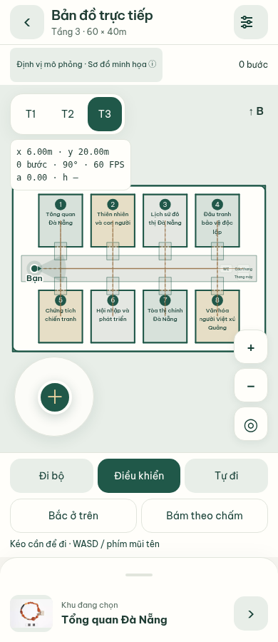
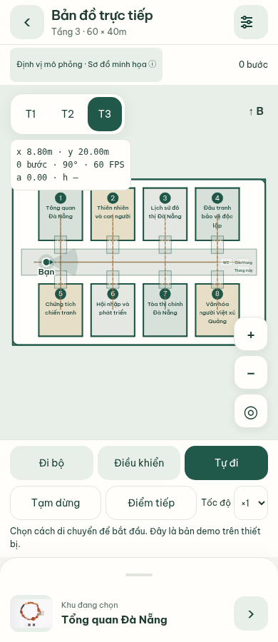
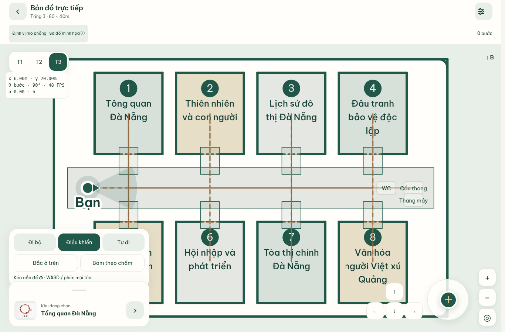

# Bản đồ trực tiếp — Giai đoạn 1

Bản nháp 7.2.0, ngày 18/11/2026, dựa trên `bfaa3b4`. Chưa hợp nhất vào main hoặc thay website Pages đang chạy. Chỉ làm lõi mô phỏng, không thêm GPS hay backend. Mọi vị trí, tường, khoảng cách, tiện ích và phân tầng trong bản đồ đều là thiết kế minh họa cho lớp học.

## Có thể thử ngay

- Ba tầng SVG với 15 chủ đề hiện có, hành lang, tường, cửa, quầy vé, WC, cầu thang/thang máy và lối ra.
- Chấm Bạn có nón hướng nhìn, pulse và vệt đi; va chạm có trượt dọc biên, tín hiệu màu/rung nhẹ khi chạm tường.
- Đi bộ: xin quyền chuyển động/hướng từ nút chạm, đếm bước, làm mượt góc, hiệu chuẩn và xoay hướng ±90°. Hướng tương đối chỉ dùng sau hiệu chuẩn; không được mô tả là la bàn Bắc thật.
- Điều khiển: joystick, nút hướng trên desktop và WASD/mũi tên. Không tăng tốc khi đi chéo; bám lối đi không giữ chấm mắc ở giữa hành lang khi rẽ.
- Tự đi: qua các phòng bằng graph, phát/tạm dừng, tốc độ ×1/×2/×4, tua đến điểm tiếp và dừng tại điểm. Ưu tiên thứ tự các chủ đề trên tầng trong lộ trình cá nhân nếu có.
- Kéo bản đồ, chụm hai ngón, zoom, về vị trí tôi, bật/tắt bám chấm, Bắc-lên hoặc Theo-hướng-đi. Bottom sheet mở bằng chạm hoặc kéo tay nắm.
- Cài đặt: độ nhạy, hệ số bước ×1/×2/×3/×4/×6, bám lối đi, bật chạm giữ để đặt vị trí và đặt lại vị trí.
- `?debug=1`: vùng đi được, graph, tọa độ, số bước, heading, tín hiệu gia tốc và FPS. Chạm giữ đặt chấm chỉ nhận vị trí đi được.
- Không có tín hiệu cảm biến sau 3 giây: báo cách phục hồi; nút Điều khiển/Tự đi luôn có sẵn. Rời màn hình, ẩn tab hoặc chuyển chế độ sẽ dừng cảm biến. Quyền trả về muộn không tự bật lại cảm biến.
- Tải module bản đồ khi cần. Service worker lưu module và ba JSON để chạy ngoại tuyến sau khi cài cache thành công.
- Nhãn mới có VI/EN/KO/ZH, nút tối thiểu 48px; hỗ trợ reduced motion và safe area. Tắt sensor/RAF khi rời màn, không gửi vị trí/chuyển động đi đâu.

Chưa triển khai trong giai đoạn này: thông báo vào khu kèm âm thanh, cộng tiến độ/huy hiệu, hỏi Mây theo khu tự động, tìm đích và chỉ dẫn rẽ, tự chuyển tầng, onboarding ba bước và mini-map. Cầu thang/graph đã có dữ liệu nối tầng để tiếp tục Giai đoạn 2; hiện đổi tầng bằng nút tầng.

## Ảnh chạy thử







Các ảnh là Chromium giả lập kích thước, không phải ảnh chứng minh cảm biến trên thiết bị vật lý.

## File mã đầy đủ

Mở từng liên kết để đọc toàn bộ file; không có đoạn giữ chỗ “giữ nguyên phần còn lại”.

| File mới | Nội dung |
| --- | --- |
| [live-map-config.js](../../live-map-config.js) | Hằng số bước, hệ số phóng, lọc hướng, độ nhạy, joystick, va chạm, zoom, trail. |
| [live-map-engine.js](../../live-map-engine.js) | Polygon, va chạm chia bước nhỏ, trượt, bám trục, đường graph cục bộ, góc tròn, bộ đếm bước. |
| [live-map-sensors.js](../../live-map-sensors.js) | Xin quyền, iOS/Android, timeout, ưu tiên hướng absolute và dọn listener. |
| [live-map-entry.js](../../live-map-entry.js) | Nạp bundle khi mở bản đồ, có thử lại. |
| [live-map.js](../../live-map.js) | SVG, camera, ba chế độ, joystick, bàn phím, pinch, bottom sheet, cài đặt và debug. |
| [live-map.css](../../live-map.css) | Toàn màn hình, portrait/landscape/desktop, vùng chạm và hiệu ứng. |
| [live-map-i18n.js](../../live-map-i18n.js) | Toàn bộ chuỗi mới, bốn ngôn ngữ. |
| [floor-1.json](../../data/maps/floor-1.json), [floor-2.json](../../data/maps/floor-2.json), [floor-3.json](../../data/maps/floor-3.json) | `size`, `walls`, `walkable`, `zones`, `pois`, `connectors`, `graph`, `start`, `tour`. |
| [config.js](../../config.js) | URL backend công khai, không chứa API key. |
| [build_demo_maps.py](../../scripts/build_demo_maps.py) | Dựng lại sơ đồ minh họa khi cần; không chạy tự động trong build, để giữ sửa tay trong JSON. |

File tích hợp đã sửa: `app.js`, `experience.js`, `index.html`, `bootstrap.js`, package/lock, `scripts/build-assets.mjs`, `sw.js`, trình xác minh và workflow, README và hướng dẫn AI. Các file test mới: `tests/live-map.test.mjs`, `tests/live-map.cjs`; test hồi quy, a11y và nâng cache được cập nhật theo cấu hình file và màn bản đồ mới.

Các bundle đã sinh: `bootstrap-7.2.0.js`, `app-foundation-7.2.0.js`, `app-core-7.2.0.js`, `app-runtime-7.2.0.js`, `app-styles-7.2.0.css`, `app-map-7.2.0.js`. Không sửa trực tiếp bundle; sửa nguồn rồi build. Bundle 7.1 được giữ để tương thích bản cũ. Chưa sửa corpus `data/museum-content.json` hoặc thay ảnh hiện vật.

## Chạy bản nháp

Mở terminal ở thư mục `bao-tang-da-nang-v6`:

```sh
npm ci
npm run build
python3 -m http.server 8877 --bind 0.0.0.0
```

Trên Windows có thể dùng `py -3` thay `python3`. Mở `http://localhost:8877/`; chọn ngôn ngữ, rồi thẻ Bản đồ trên trang chủ. Có thể thêm `?debug=1` vào địa chỉ trước khi mở bản đồ. Địa chỉ này khác môi trường kiểm thử, nơi server chạy từ gốc repository với đường dẫn `/bao-tang-da-nang-v6/`.

Điện thoại cùng Wi-Fi có thể mở `http://IP-máy-tính:8877/` để thử joystick/tự đi. **Kiểm tra cảm biến cần HTTPS**, như bản Pages/preview sau khi được duyệt xuất bản. Truy cập LAN HTTP không thay thế được bài thử cảm biến. Không cần bật GPS, API key hay backend mới cho bản đồ.

## Checklist trên iPhone Safari và Chrome Android

1. Mở bản này bằng HTTPS trong Safari/Chrome, không mở trong trình duyệt Zalo/Facebook. Chọn ngôn ngữ → Bản đồ → Đi bộ → Bật chế độ đi bộ. Trên iPhone, chấp nhận quyền chuyển động/hướng khi được hỏi.
2. Đứng yên 5 giây: bộ đếm không nên tự tăng. Mở cài đặt → quay mặt về hướng sẽ đi → Đặt hướng → đóng. Đi khoảng 10 bước; mặc định tương ứng khoảng 21 mét mô phỏng, có thể bị tường chặn nếu quay sai hướng.
3. Thử quay điện thoại qua ranh giới 359°/0° và xoay ngang màn hình: nón hướng không quay giật cả vòng. Nếu hướng lệch, hiệu chuẩn lại hoặc dùng ±90°.
4. Nếu không nhận bước hoặc đếm dư: chỉnh độ nhạy một nấc, thử lại. Đừng tăng hệ số bước để chữa đếm nhầm; hệ số chỉ đổi quãng đường mỗi bước đã đếm.
5. Từ chối quyền hoặc tắt quyền: thấy thông báo; bấm Điều khiển hoặc Tự đi là tiếp tục demo. Không có tín hiệu trong 3 giây cũng phải có hướng dẫn.
6. Kéo joystick vào tường, giữ phím chéo trên máy tính và đi qua cửa: chấm không xuyên tường, không kẹt khi rẽ khỏi hành lang. Chạm giữ ngoài vùng đi được không đặt được chấm.
7. Tự đi → Phát → tốc độ ×4 → Tạm dừng → Điểm tiếp. Chuyển tầng bằng nút T1/T2/T3: dừng chế độ đang chạy, đưa chấm về điểm bắt đầu của tầng được chọn.
8. Kéo, pinch, zoom, về vị trí tôi; thử cả Bắc-lên và Theo-hướng-đi. Mở danh sách khu bằng chạm/kéo tay nắm. Thử màn 360–430px và xoay ngang; mọi nút cần chạm được, không bị thanh trình duyệt che.
9. Rời bản đồ về trang cũ, tắt màn hình hoặc đưa app xuống nền: cảm biến dừng. Quay lại phải chủ động bật lại đi bộ; tự đi không âm thầm chạy tiếp.
10. Mở `?pwa=1` khi thử localhost, đợi cache cài xong; mở bản đồ một lần, ngắt mạng và tải lại. Cả ba tầng và Tự đi phải dùng được. Nếu lần đầu chưa tải được JSON/module, có thông báo và nút thử lại; không thay bằng dữ liệu giả.
11. Hồ sơ → khung QR: dùng điện thoại khác quét, mở đúng hồ sơ. Menu chat không còn cấu hình AI công khai.

## Chỉnh nhanh trước buổi demo

- Trong `live-map-config.js`: tăng `mapScale` nếu ít chỗ đi; chỉnh `sensitivity`, `stepThreshold`, `minStepMs` nếu máy đếm khác. Chạy build lại sau khi sửa. Có thể đổi độ nhạy/hệ số ngay trong UI trong phiên hiện tại.
- Cài đặt được giữ trong phiên, không âm thầm lưu dấu vết chuyển động hoặc tọa độ.
- Chuẩn bị sẵn phương án Tự đi ×2 hoặc ×4 và sạc điện thoại. Không hứa cảm biến luôn hoạt động trên mọi thiết bị.
- Trong `config.js`, chỉ đặt URL Worker nếu đã có backend hoạt động. Giá trị localStorage từ menu cũ không còn được dùng. API key vẫn chỉ đặt trên Worker.

## Kiểm thử đã thực hiện

- **126/126** kiểm tra Node: gồm 10 bài hình học, bước chân, lắc tay, góc tròn, graph, scope hồ sơ, bám lối đi và i18n mới; các bài corpus/quiz/RAG/Worker cũ vẫn qua.
- **12/12 nhóm** trình duyệt: các cỡ 360×800, 390×844, 430×932, 844×390, 1366×900; joystick/WASD, tự đi/tua/tạm dừng, quyền bị từ chối/quyền trả muộn, im lặng 3 giây, 10 bước tổng hợp, pan/pinch/teleport, bốn ngôn ngữ, QR và PWA offline.
- **24/24 nhóm** hồi quy chức năng cũ; **19/19** Python.
- Axe trên 10 màn chính (đợi bản đồ nạp xong) và hai hộp thoại bản đồ: không phát hiện vi phạm WCAG 2 A/AA tự động.
- Xác minh HTTP local: bộ tài nguyên đúng byte và **200/200** ảnh hiện vật giải mã được; đây không phải bằng chứng xuất bản Pages.
- Nâng cache 7.0 thật sang bản mới: không tự tải lại trang đang viết, giữ lượt xem/ảnh đã cache và mở lại ngoại tuyến.
- Quan sát RAF trên Chromium desktop khoảng 60 FPS khi chạy; chưa phải số đo trên điện thoại tầm trung.
- Lighthouse 13.0.1 mobile, lần tải lạnh trang đầu trên server local có gzip: Performance **87**, Accessibility **100**, Best Practices **100**. Không phải số đo trên Pages; cũng không phải phép đo FPS của bản đồ.

Báo cáo: [map-tests.json](map-tests.json), [regression-tests.json](regression-tests.json), [accessibility-tests.json](accessibility-tests.json), [dialog-accessibility.json](dialog-accessibility.json), [performance-local.json](performance-local.json).

Chưa kiểm chứng: cảm biến, pin, rung, quyền Safari và chuyển nền trên điện thoại vật lý. Cần làm checklist trên chính điện thoại sẽ dùng để demo trước khi kết luận đạt mục tiêu đi bộ 10 bước. Không khẳng định bài mô phỏng thay cho kiểm thử thiết bị thật.
