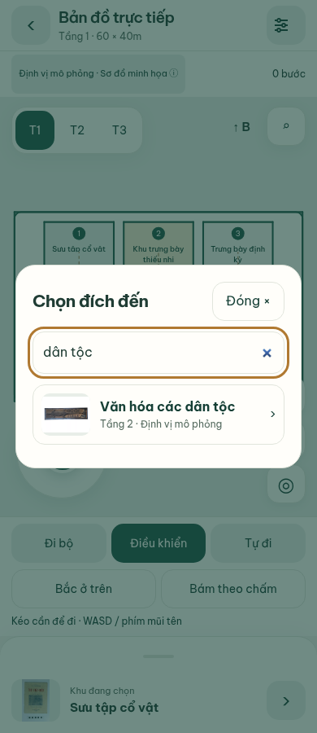
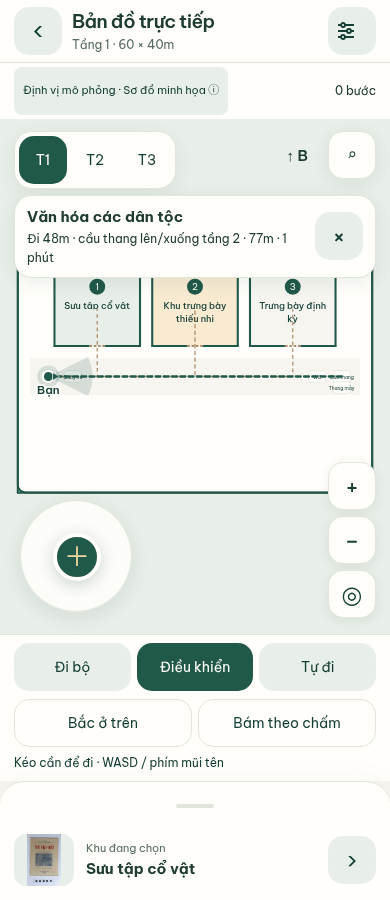
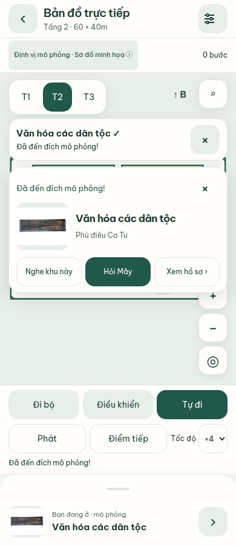
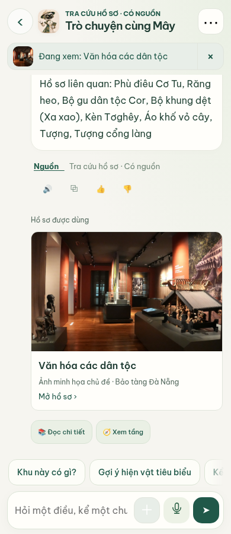
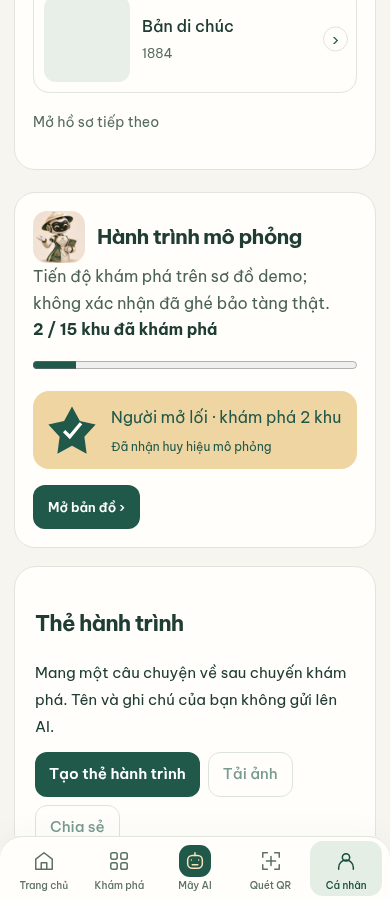
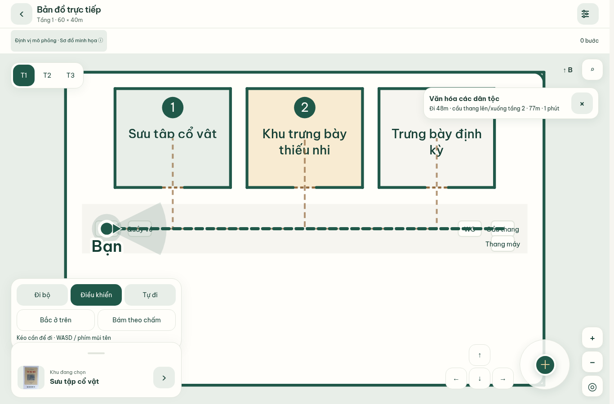

# Bản đồ trực tiếp — Giai đoạn 2

Bản nháp 7.3.0, ngày 18/11/2026, nối tiếp Giai đoạn 1 (`99e0a3d`). Nhánh `feat/live-map-stage2`. Chưa hợp nhất vào main, chưa thay website Pages đang chạy. Không thêm backend, GPS hoặc hồ sơ lịch sử giả.

## Các chức năng mới

1. **Vào khu → thẻ có ảnh.** Thẻ hiện tên khu, ảnh hiện vật liên quan hoặc ảnh không gian có nguồn. Có Nghe khu này, Hỏi Mây và Xem hồ sơ. Mỗi lượt đi ngang phát một lần; có cooldown 8 giây và khoảng đệm ngoài biên để tránh nhấp nháy khi đứng ở cửa. Thẻ tự ẩn sau 8 giây; người dùng đang thao tác/đọc bằng bàn phím hoặc nghe thì giữ lại.
2. **Âm báo tùy chọn.** Trong cài đặt bản đồ có Âm báo khi vào khu, mặc định tắt. Safari cần chạm bật để mở AudioContext. Có rung nhẹ nếu máy hỗ trợ; reduced motion giảm hiệu ứng/rung. Không tự phát thuyết minh khi chưa bấm nghe.
3. **Mây hiểu khu đang hỏi.** Hỏi Mây từ thẻ ghim chủ đề, xóa pin hiện vật cũ, có ảnh và ba câu hỏi riêng cho khu. Mây gửi câu hỏi khởi đầu bằng tên chủ đề để lấy đúng nội dung/nguồn. Mở hồ sơ hoặc xóa ngữ cảnh vẫn dùng router cũ.
4. **Tiến độ và huy hiệu mô phỏng.** Mỗi khu mới tăng tiến độ khu; hai khu khác nhau nhận huy hiệu Người mở lối một lần. Thẻ Cá nhân, nhật ký và nhiệm vụ được nối với hệ thống có sẵn. Nhật ký ghi rõ Mô phỏng. Mỗi lượt vào chỉ ghi nhận một hiện vật phù hợp; không cộng cả bộ sưu tập khi chỉ đi ngang một phòng. Lượt vào sau có thể giới thiệu hồ sơ liên quan chưa xem. Tiến độ chỉ lưu ID tại trình duyệt, không lưu tọa độ hoặc cảm biến.
5. **Tìm đích → chỉ đường.** Nút tìm kiếm trên bản đồ mở danh sách khu, 33 hồ sơ cơ sở 1 được ghép theo chủ đề và các tiện ích trên sơ đồ (WC, cầu thang, thang máy, quầy vé, lối ra). Dijkstra nối graph ba tầng, vẽ nét đứt, có khoảng cách, ước tính phút và hướng rẽ. Khoảng cách/thời gian thuộc mô phỏng, không phải số đo bảo tàng.
6. **Đổi tầng theo đường dẫn.** Khi đi bộ, joystick hoặc Tự đi tới điểm nối mà đường dẫn yêu cầu, chấm tự chuyển sang tầng tiếp theo. Giữ cảm biến trong chuyển tầng có chủ đích; không bật lại quyền đã từ chối. Có cooldown, không nhảy qua lại khi đứng yên ở cầu thang. Không chọn ngẫu nhiên một tầng khi đi tự do chưa có đích; lúc đó dùng T1/T2/T3.
7. **Đi lệch → tính lại.** Lệch khỏi đường quá 2,5m thì dựng lại đường từ vị trí mô phỏng hiện tại, tối đa một lần mỗi 1,2 giây. Điểm nối từ vị trí hiện tại vào graph phải đi được, tránh đường cắt xuyên tường.
8. **Lộ trình cá nhân.** Trong tìm đích có Dùng lộ trình cá nhân khi đã tạo lộ trình. Các điểm dừng giữ đúng thứ tự, kể cả khi quay lại tầng trước. Chọn Tự đi rồi Phát để chạy theo đường này; dừng ngắn tại mỗi điểm.
9. **Từ hồ sơ → đường dẫn.** Nút Chỉ đường trên sơ đồ mô phỏng mở đúng đích hiện vật. Hồ sơ cơ sở 2 và hồ sơ tham khảo ngoài Đà Nẵng bị vô hiệu hóa nút này; không được gán vào bản đồ cơ sở 1.

Thao tác đổi tầng thủ công vẫn đưa chấm về điểm bắt đầu của tầng đó như Giai đoạn 1. Nếu đang chỉ đường, đường được tính lại từ vị trí mới. Rời bản đồ sẽ dừng Tự đi/cảm biến; quay lại cần chủ động Phát/Bật đi bộ. Đích còn lại được giữ trong phiên.

## Ảnh chạy thử













Đây là ảnh Chromium giả lập 390/1366px. Các ví dụ tiến độ là dữ liệu mô phỏng trên trình duyệt thử; không chứng minh đã đi tại bảo tàng hay đã thử cảm biến vật lý.

## Mã nguồn hoàn chỉnh

| File thêm/sửa | Vai trò |
| --- | --- |
| [live-map-navigation.js](../../live-map-navigation.js) — mới | Graph liên tầng, Dijkstra, nhiều điểm dừng, kiểm tra lệch đường, hướng rẽ, tracker khu/cooldown. |
| [live-map-features.js](../../live-map-features.js) — mới | Tìm đích, thẻ ảnh, thuyết minh/âm báo, chỉ đường, đến đích, đổi tầng, kết nối renderer. |
| [map-journey.js](../../map-journey.js) — mới | ID khu/hiện vật đã khám phá, huy hiệu, thẻ tiến độ Cá nhân và xóa dữ liệu. |
| [live-map.js](../../live-map.js) | Các hook nối tính năng mới với joystick, bước chân, Tự đi, đổi tầng và lifecycle cũ. |
| [live-map-config.js](../../live-map-config.js), [live-map-i18n.js](../../live-map-i18n.js), [live-map.css](../../live-map.css) | Cooldown, bán kính đến nơi, ngưỡng tính lại, nhãn bốn ngôn ngữ, đường dẫn/thẻ ảnh/tìm kiếm. |
| [experience.js](../../experience.js), [experience-i18n.js](../../experience-i18n.js), [profile.js](../../profile.js), [app.js](../../app.js) | Pin chủ đề Mây, nút chỉ đường trên hồ sơ, nhiệm vụ và nhật ký mô phỏng. |
| [live-map-entry.js](../../live-map-entry.js) | Nhận yêu cầu mở đích từ trang hiện vật; nạp bộ bản đồ khi cần. |
| `bootstrap.js`, `index.html`, package/lock, `scripts/build-assets.mjs`, `sw.js` | Tài nguyên 7.3.0; lưu cả đường dẫn/bản đồ để dùng ngoại tuyến. |
| `scripts/verify_published_v6.py`, workflow xác minh | Kiểm tra đúng bundle, module mới, JSON và ảnh khi xuất bản sau này. |
| [live-map-navigation.test.mjs](../../tests/live-map-navigation.test.mjs), [live-map-stage2.cjs](../../tests/live-map-stage2.cjs) — mới | Hình học liên tầng, thứ tự hành trình, va chạm/cooldown và luồng UI thực tế. |

Mỗi liên kết là file đầy đủ. Các bundle `*-7.3.0.js/css` đã build sẵn. Corpus 200 hiện vật, ảnh gốc và JSON sơ đồ Giai đoạn 1 giữ nguyên. Không cần chép từng đoạn code từ hội thoại.

## Chạy và thử trên điện thoại

Từ thư mục `bao-tang-da-nang-v6`:

```sh
npm ci
npm run build
python3 -m http.server 8877 --bind 0.0.0.0
```

Mở `http://localhost:8877/`, chọn ngôn ngữ, chọn Bản đồ. Điện thoại cùng Wi-Fi mở `http://IP-máy-tính:8877/` để thử joystick/Tự đi. Cảm biến cần bản HTTPS khi đưa bản nháp lên preview/Pages sau khi duyệt. Không cần tài khoản, API key hay backend để chạy đường dẫn và tiến độ.

**Checklist Safari iPhone / Chrome Android:**

- Tìm “dân tộc” → chọn khu tầng 2 → có đường, hướng rẽ và số mét/phút mô phỏng. Đổi joystick ↔ Đi bộ ↔ Tự đi không mất đích.
- Tự đi ×4 → tới cầu thang → tự chuyển tầng 2 → báo đến nơi. Đứng yên không nhảy tầng ngược lại.
- Đi bộ: bật cảm biến trên HTTPS, đặt hướng, đi tới điểm nối trên đường. Chuyển tầng giữ nhận bước; rời bản đồ tắt cảm biến. Nếu máy không nhận cảm biến, dùng joystick/Tự đi.
- Vào khu → ảnh/tên khu đúng; đứng ở cửa không phát thẻ liên tục. Ra xa rồi quay lại sau cooldown mới có lượt tiếp. Bật/tắt âm báo và thử nút nghe bằng giọng có sẵn trên máy.
- Bấm Hỏi Mây → chip ghim tên khu; câu khởi đầu và thẻ nguồn đúng khu. Bấm Xem hồ sơ → đúng hiện vật được giới thiệu trên thẻ.
- Tạo lộ trình cá nhân có điểm ở cả ba tầng → quay lại bản đồ → tìm đích → Dùng lộ trình cá nhân → Tự đi. Thứ tự các điểm không bị sắp lại theo tầng.
- Dùng `?debug=1`, bật chạm giữ trong cài đặt, đặt chấm vào phòng ngoài đường dẫn: đường được tính lại qua cửa, không xuyên tường. Không đặt được chấm ngoài vùng đi được.
- Mở hai khu khác nhau → Cá nhân thấy huy hiệu và nhật ký có nhãn Mô phỏng. Tải lại vẫn giữ ID đã khám phá; Xóa dữ liệu cá nhân xóa cả tiến độ bản đồ và huy hiệu.
- Hồ sơ cơ sở 1 có nút chỉ đường; hồ sơ cơ sở 2/V&A/VNMH không được định vị vào cơ sở 1.
- Thử màn 360–430px, xoay ngang, bật bàn phím khi tìm đích, mở/đóng thẻ và bottom sheet, bật reduced motion.
- Sau khi cache PWA cài thành công, tắt mạng và tải lại: tìm đích, đường liên tầng và Tự đi vẫn chạy. Ảnh chưa xem có thể cần mạng; không thay ảnh lỗi bằng hiện vật khác.

## Kịch bản demo khoảng 60 giây

1. 0–10s: mở bản đồ, bật đi bộ và Đặt hướng. Nếu cảm biến không sẵn sàng, chọn Tự đi ngay.
2. 10–20s: vào khu đầu hoặc Tự đi → Điểm tiếp. Thẻ ảnh hiện ra; bấm Nghe khu này/Hỏi Mây để cho thấy nguồn và ngữ cảnh.
3. 20–35s: quay lại bản đồ, tìm khu Văn hóa các dân tộc ở tầng 2, chọn Tự đi ×4 và Phát.
4. 35–50s: chấm qua điểm nối, sơ đồ tự chuyển tầng, báo đến khu có ảnh.
5. 50–60s: Cá nhân → tiến độ hai khu và huy hiệu Người mở lối, nhật ký ghi Mô phỏng.

Không cần nối AI server để trình diễn luồng này. Mây mặc định tra cứu hồ sơ tại máy; TTS phụ thuộc giọng trình duyệt/hệ điều hành.

## Bằng chứng kiểm thử

- 132 kiểm tra Node: corpus/RAG/quiz/Worker cũ cùng hình học, tracker và đường liên tầng; tất cả qua.
- 9 nhóm UI mới: đi tới tầng 2, lộ trình ba tầng đúng thứ tự, cooldown/tái vào khu, Mây/TTS, scope hồ sơ, đi lệch/WC, giữ cảm biến qua chuyển tầng, bốn ngôn ngữ, offline/xóa tiến độ; tất cả qua.
- 12 nhóm Giai đoạn 1 và 24 nhóm hồi quy cũ; tất cả qua. 19 bài Python qua.
- Axe trên 10 màn chính và các trạng thái tìm đích/đường dẫn/thẻ khu/chat/Cá nhân mới: không phát hiện vi phạm WCAG 2 A/AA tự động. Đây không phải chứng nhận WCAG toàn diện.
- HTTP local: bundle/module đúng byte; 200/200 ảnh hiện vật giải mã được, không đổi corpus. Không phải bằng chứng xuất bản Pages.
- Nâng cache thật từ 7.0: giữ ảnh/lượt xem và không tự tải lại trang đang viết.
- Lighthouse 13.0.1 mobile trên server local có gzip, tải lạnh trang đầu: Performance **85**, Accessibility **100**, Best Practices **100**. Không phải phép đo trên Pages hoặc FPS của bản đồ.

Báo cáo máy đọc được: [stage2-tests.json](stage2-tests.json), [stage1-tests.json](stage1-tests.json), [regression-tests.json](regression-tests.json), [accessibility-tests.json](accessibility-tests.json), [feature-accessibility.json](feature-accessibility.json), [performance-local.json](performance-local.json).

Kiểm thử UI dùng Chromium, thời gian và cảm biến tổng hợp. Chưa thay thế thử quyền/cảm biến, rung, giọng đọc, bàn phím và pin trên điện thoại vật lý. Cần làm checklist bằng chính máy sẽ demo.

Giai đoạn 3 còn lại: onboarding ba bước, mini-map, rà soát thiết bị thật và tối ưu cuối cùng. Theo quy trình yêu cầu, dừng sau bàn giao Giai đoạn 2 để chờ duyệt.
