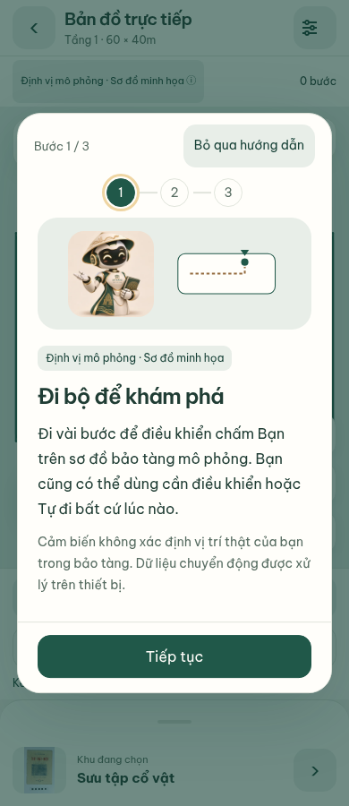
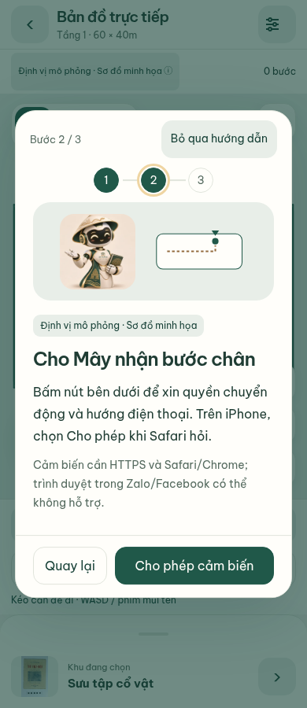
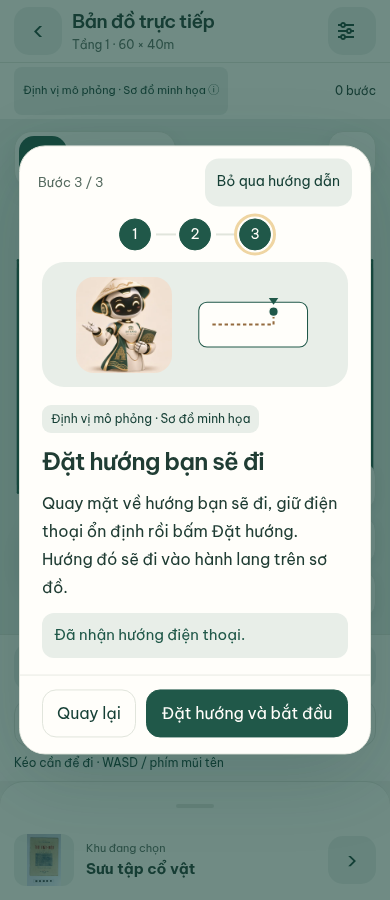
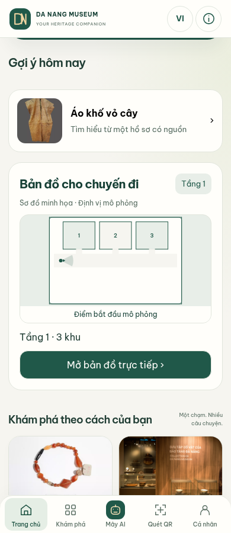
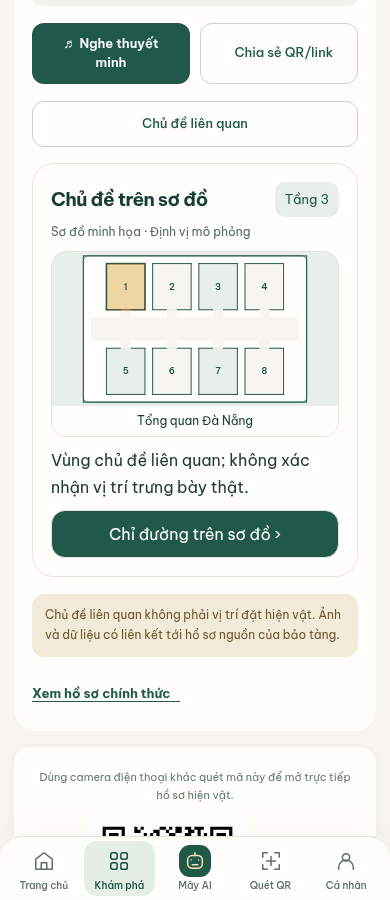
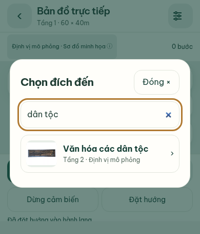

# Bản đồ trực tiếp — Giai đoạn 3, bản bàn giao

Bản nháp 7.4.0, ngày 19/11/2026 (giờ Việt Nam). Nhánh `feat/live-map-stage3`, nối tiếp Giai đoạn 2 `e9f80c2`. Chưa hợp nhất main hoặc thay website Pages. Giữ palette, Mây, năm tab, dữ liệu/ảnh của 200 hồ sơ và sơ đồ minh họa ba tầng.

## Hoàn thiện trong giai đoạn này

- **Hướng dẫn ba bước:** giới thiệu đi bộ → xin quyền từ nút chạm → đặt hướng. Bỏ qua ở bất kỳ bước nào; nhớ hoàn tất/bỏ qua trên trình duyệt. Cài đặt bản đồ có Đặt lại hướng dẫn 3 bước. Phát lại không tự xin quyền, không xóa nhật ký/huy hiệu.
- **Quyền và hiệu chuẩn:** giữ cảm biến sau khi hoàn tất hướng dẫn và chuyển giao đúng sang chế độ Đi bộ. Nếu la bàn trả về muộn, hướng đầu tiên vẫn được căn vào hành lang. Rời màn/ẩn tab/bỏ qua khi đang chờ sẽ hủy yêu cầu cũ, không tự bật lại khi quyền trả về muộn. Quyền bị từ chối có lối dùng joystick/Tự đi.
- **Mini-map:** trang chủ có xem trước nhẹ; hồ sơ cơ sở 1 có chủ đề được đánh dấu trên sơ đồ và nút chỉ đường. Hồ sơ cơ sở 2/ngoài Đà Nẵng không được gán vào sơ đồ cơ sở 1. Vị trí sau khi đi chỉ giữ trong RAM của phiên và có nhãn mô phỏng; không lưu tọa độ/cảm biến.
- **Tải theo nhu cầu:** mini-map đọc JSON khi cần và chia sẻ promise đã kiểm tra với bản đồ đầy đủ. Engine, cảm biến, hướng dẫn và CSS bản đồ chỉ nạp lúc mở bản đồ. Request bị treo có timeout/thử lại. PWA cache cả CSS mới và ba tầng. Chưa xác nhận màn chào thì không dựng/tải ảnh trang chủ bị che phía sau; giữ ảnh đầy đủ khi bắt đầu.
- **Khả năng tiếp cận:** mọi hộp thoại chặn di chuyển phía sau; Escape đóng/bỏ qua đúng màn. Nút camera và ARIA đồng bộ sau recenter/pan/đổi hướng. Kéo bảng khu không bị lần click kế tiếp đảo ngược. Mini-map không bị flex trang chủ ép còn mỗi tiêu đề. Hộp tìm đích nằm trong visualViewport khi bàn phím mở; hỗ trợ safe area, reduced motion và nhãn bốn ngôn ngữ.
- **Hiệu năng bản đồ:** đo viewport bằng ResizeObserver, không đọc layout/ma trận SVG ở mỗi khung hình. Chỉ ghi transform khi thực sự đổi; mini-map chỉ nhận pose tối đa khoảng 8 lần/giây và không redraw lúc đang ở màn bản đồ. Tính vị trí chạm mới đọc ma trận SVG. Ngắt cảm biến/RAF khi rời màn.

Các chức năng Giai đoạn 1–2 vẫn có: ba chế độ, va chạm, hướng nhìn, vệt đi, debug, thẻ khu có ảnh/nghe/Mây, tiến độ mô phỏng, lộ trình nhiều điểm, chỉ đường/reroute/đổi tầng và offline. Không thêm backend hoặc tự dựng dữ liệu lịch sử.

## Ảnh chạy thử













Ảnh là Chromium giả lập kích thước; trạng thái cảm biến trong ảnh là dữ liệu thử tổng hợp. Không phải bằng chứng cảm biến vật lý trên iPhone/Android.

## Mã đầy đủ và các file bàn giao

| File | Nội dung |
| --- | --- |
| [live-map-onboarding.js](../../live-map-onboarding.js), [live-map-onboarding.css](../../live-map-onboarding.css) — mới | Dialog ba bước, quyền từ thao tác chạm, bỏ qua/nhớ/phát lại, bốn ngôn ngữ. |
| [mini-map.js](../../mini-map.js), [mini-map.css](../../mini-map.css) — mới | Xem trước SVG nhẹ, pose phiên trong RAM, loader JSON dùng chung, scope dữ liệu và lỗi/thử lại. |
| [live-map.js](../../live-map.js) | Tích hợp hướng dẫn, pause hộp thoại, hiệu chuẩn muộn, đồng bộ camera, swipe, ResizeObserver và phát pose nội bộ. |
| [live-map-features.js](../../live-map-features.js) | Dùng ResizeObserver đo thẻ đường dẫn khi đổi kích thước thay vì đọc layout liên tục. |
| [live-map-entry.js](../../live-map-entry.js) | Nạp JS/CSS có phiên bản khi mở bản đồ, timeout và khôi phục sau lỗi. |
| [mobile.js](../../mobile.js), [live-map.css](../../live-map.css), [live-map-i18n.js](../../live-map-i18n.js) | VisualViewport, hộp thoại trên bàn phím, nhãn reset hướng dẫn. |
| [experience.js](../../experience.js) | Hoãn ảnh trang chủ đến khi xác nhận ngôn ngữ/tên; tránh tải ảnh bị che khi khách còn ở màn chào. |
| [config.js](../../config.js) | Thời hạn tải asset công khai, không có API key. |
| `bootstrap.js`, `index.html`, package/lock, `scripts/build-assets.mjs`, `sw.js` | Tài nguyên 7.4.0, mini-map trong runtime nhẹ, map CSS tải riêng và cache ngoại tuyến. |
| [live-map-stage3.cjs](../../tests/live-map-stage3.cjs), [live-map-final.cjs](../../tests/live-map-final.cjs), [map-onboarding.cjs](../../tests/map-onboarding.cjs), [map-onboarding.test.mjs](../../tests/map-onboarding.test.mjs), [mini-map.cjs](../../tests/mini-map.cjs) — mới | Kiểm thử tích hợp và hồi quy cụ thể của giai đoạn này. |

Các test cũ được giữ, chỉ đánh dấu hướng dẫn đã hoàn tất trong fixture để tiếp tục kiểm tra đúng chức năng của chúng. Hướng dẫn lần đầu được kiểm tra riêng, không âm thầm tắt trong sản phẩm.

Bundle đã build: `bootstrap-7.4.0.js`, `app-foundation-7.4.0.js`, `app-core-7.4.0.js`, `app-runtime-7.4.0.js`, `app-styles-7.4.0.css`, `app-map-7.4.0.js`, `map-styles-7.4.0.css`. Sửa module nguồn, rồi build; không sửa tay bundle. ZIP bàn giao chứa toàn bộ file thêm/sửa từ bản public `bfaa3b4` qua cả ba giai đoạn. Ảnh gốc và corpus không đổi nên dùng tiếp từ repository hiện có.

## Chạy bản nháp

Trong thư mục `bao-tang-da-nang-v6`:

```sh
npm ci
npm run build
python3 -m http.server 8877 --bind 0.0.0.0
```

Mở `http://localhost:8877/`, chọn ngôn ngữ/tên. Cuộn xuống mini-map hoặc mở Bản đồ từ thẻ tính năng. Trên Windows có thể thay `python3` bằng `py -3`. Nếu server chạy từ gốc repository, đường dẫn là `/bao-tang-da-nang-v6/`.

Điện thoại cùng Wi-Fi mở `http://IP-máy-tính:8877/` để thử joystick, Tự đi, bản đồ và mini-map. Cảm biến cần HTTPS, nên thử cảm biến bằng bản preview/Pages sau khi bản này được duyệt xuất bản. Không cần tài khoản hoặc API key để dùng bản đồ. Không nhập API key vào frontend.

## Checklist thiết bị thật — cần người dùng thực hiện

Chạy trên **chính iPhone Safari/Chrome Android sẽ dùng để demo**, vì máy phát triển không có cảm biến điện thoại vật lý.

- [ ] Màn 360–430px và xoay ngang: không cuộn ngang; nút >=48px; không bị browser bar/safe area che.
- [ ] Lần đầu mở bản đồ hiện hướng dẫn, không tự xin quyền. Bỏ qua một lần rồi tải lại không hỏi lại. Cài đặt → Đặt lại hướng dẫn mở lại mà không xóa tiến độ.
- [ ] Bước 2: chạm Cho phép cảm biến, chấp nhận quyền trong Safari. Hai yêu cầu chuyển động/hướng được phát từ chính thao tác chạm.
- [ ] Bước 3: hướng mặt về hướng sẽ đi, Đặt hướng và bắt đầu; chế độ Đi bộ và cảm biến vẫn hoạt động sau khi đóng hướng dẫn.
- [ ] Đứng yên 5 giây rồi đi khoảng 10 bước, kiểm tra đếm và dịch chuyển; mặc định tương ứng khoảng 21m mô phỏng nếu không bị tường chặn. Chỉnh độ nhạy/hệ số theo máy, hiệu chuẩn lại khi cần.
- [ ] Từ chối quyền hoặc mở trong trình duyệt trong app: thông báo hữu ích, tối đa ba chạm để dùng joystick/Tự đi. Sau 3 giây không có tín hiệu phải có cách phục hồi.
- [ ] Đóng/ẩn tab khi đang chờ quyền; quay lại không tự bật cảm biến từ phản hồi cũ. Rời bản đồ dừng cảm biến và chuyển động; trở lại cần chủ động bật/Phát.
- [ ] Quay qua 359°/0°, đổi chiều màn hình và dùng Theo-hướng-đi: nón và chỉ Bắc không giật cả vòng hoặc đứng sai hướng.
- [ ] Kéo/chụm/zoom, recenter và kéo bảng khu lên/xuống. Trong hộp giải thích/cài đặt/tìm đích/hướng dẫn, chấm đứng yên.
- [ ] Mở tìm đích rồi bật bàn phím: ô nhập, kết quả và nút đóng còn thao tác được. Thử VI/EN/KO/ZH và reduced motion của hệ điều hành.
- [ ] Vào khu: thẻ ảnh đúng hồ sơ, một lần mỗi lượt; nghe thuyết minh, hỏi Mây đúng chủ đề, mở đúng hồ sơ. Âm báo/rung tùy khả năng máy và lựa chọn người dùng.
- [ ] Chọn đích tầng 2, Tự đi ×4 hoặc đi theo đường: tự đổi tầng, báo đến nơi, không xuyên tường/nhảy tầng liên tục. Lệch đường được tính lại; lộ trình cá nhân giữ thứ tự.
- [ ] Về trang chủ: mini-map thể hiện pose mô phỏng của phiên. Mở hồ sơ cơ sở 1 có vùng chủ đề; hồ sơ ngoài phạm vi không bị gán vị trí. Tải lại thì tọa độ phiên không được giữ, tiến độ ID vẫn còn.
- [ ] Sau khi cache PWA cài thành công, tắt mạng rồi tải lại: guide đã nhớ, mini-map, ba tầng, chỉ đường và Tự đi hoạt động. Ảnh chưa xem có thể cần mạng.

## Demo 60 giây

Chuẩn bị: mở sẵn HTTPS bằng Safari/Chrome, sạc pin, kiểm tra âm lượng/giọng TTS nếu dùng; có phương án Tự đi ×4. Có thể dùng Đặt lại hướng dẫn trước buổi diễn.

1. **0–12s:** chọn ngôn ngữ, mở mini-map → bản đồ; giới thiệu chip Định vị mô phỏng. Đi qua ba bước, xin quyền và đặt hướng. Nếu máy không sẵn sàng, Bỏ qua → Tự đi.
2. **12–25s:** đi vài bước/rẽ vào khu đầu, hoặc Tự đi → Điểm tiếp. Thẻ ảnh xuất hiện; bấm Nghe khu này hoặc Hỏi Mây, chỉ ra chip ngữ cảnh và nguồn.
3. **25–45s:** trở lại bản đồ, tìm Văn hóa các dân tộc tầng 2 → Tự đi ×4 → Phát. Chấm theo đường, qua điểm nối và tự đổi tầng.
4. **45–60s:** báo đến nơi, về Cá nhân xem tiến độ/huy hiệu Người mở lối và nhật ký Mô phỏng; về trang chủ xem mini-map phiên vừa đi.

Các câu trong Mây mặc định lấy từ hồ sơ tại máy. Không mô tả đây là GPS trong nhà hoặc mô hình AI đã được train mới. Không cần backend cho kịch bản bản đồ này.

## Xác minh và giới hạn

- **Lighthouse mobile local: hiệu năng 91, accessibility 100, best practices 100.** Trang chào tải nguội trên HTTP gzip với throttling mô phỏng; FCP 1,0s, LCP 3,4s, TBT 110ms, CLS 0,012. Hoãn ảnh trang chủ bị che giảm tổng tải lượt đo từ khoảng 2,9MiB xuống 422KiB. Không phải số đo Pages, FPS bản đồ hay thiết bị thật. [Chi tiết phép đo](performance-local.json).
- 134 bài Node qua: gồm dữ liệu thật, RAG/quiz/Worker, hình học/đường liên tầng/cooldown, cờ onboarding và bốn ngôn ngữ.
- 24 nhóm hồi quy app, 12 nhóm lõi bản đồ, 9 nhóm Giai đoạn 2, 4 nhóm tích hợp Giai đoạn 3, 4 nhóm sửa lỗi cuối, 6 nhóm mini-map và các tình huống adapter onboarding đều qua.
- Axe tự động kiểm tra 10 màn chính cùng mini-map và các bước hướng dẫn; không phải chứng nhận WCAG đầy đủ.
- Dữ liệu/corpus và 200 ảnh gốc giữ nguyên; bộ xác minh HTTP kiểm tra tài nguyên build và giải mã đủ ảnh.
- Chưa kiểm chứng cảm biến, pin, rung, TTS hệ điều hành và bàn phím trên thiết bị vật lý. Kiểm tra Chromium/cảm biến tổng hợp không thay thế các ô checklist trên.

[Tổng hợp kiểm thử](validation-summary.json) · [Log đầy đủ](verification-logs.txt) · [Tích hợp Giai đoạn 3](stage3-tests.json) · [Hồi quy app](app-regressions.json) · [Mini-map](mini-map-tests.json) · [Ảnh/asset HTTP local](assets-and-photos.json) · [Axe hướng dẫn/bàn phím](onboarding-accessibility.json).

Sau khi duyệt bản bàn giao, bước phát hành là hợp nhất nhánh vào main, đợi Pages và workflow xác minh tài nguyên/200 ảnh/Lighthouse trên URL công khai. Các số đo local không được dùng để tuyên bố đã xuất bản.
