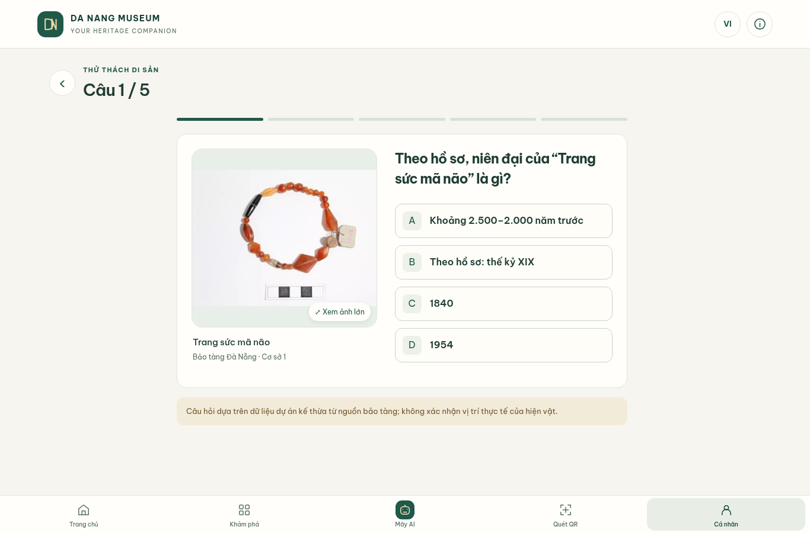
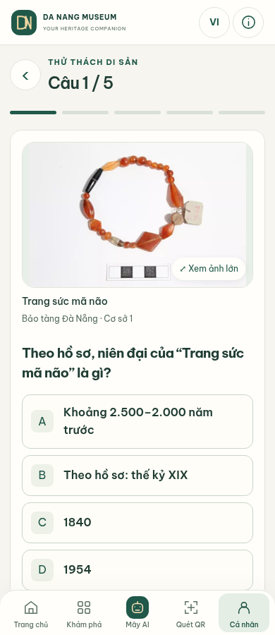
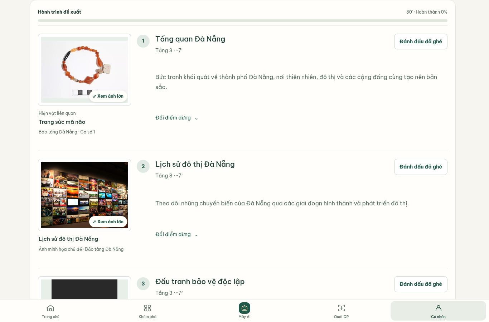
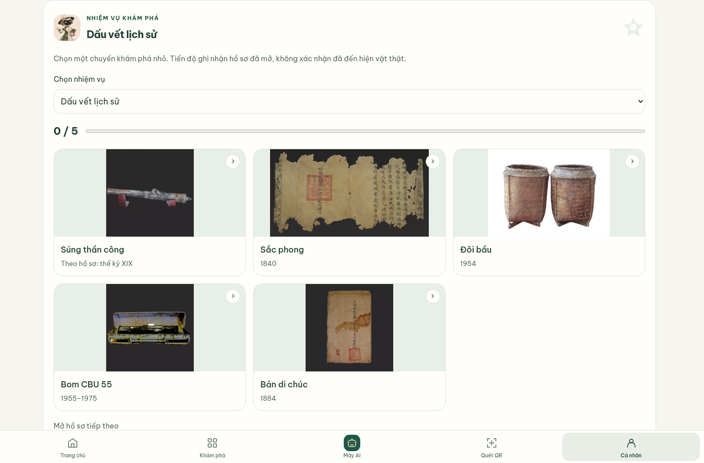
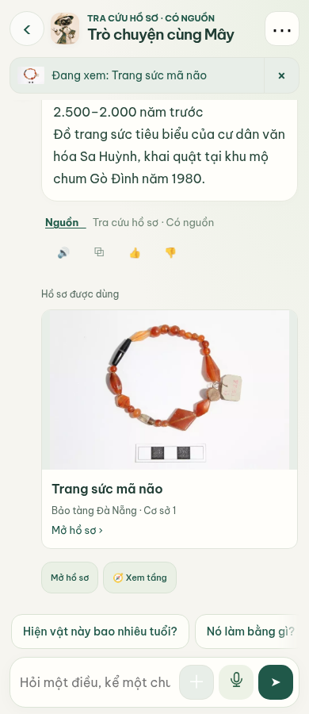
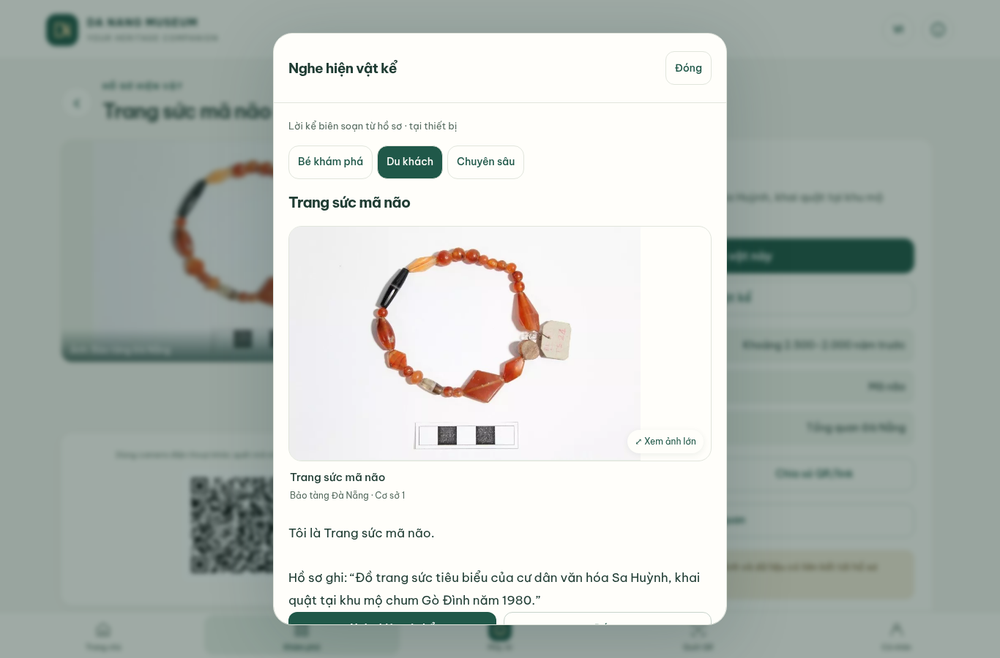

# 7.1 — Đưa ảnh thật vào từng hoạt động

Ngày kiểm tra: 18/11/2026. Nâng cấp từ bản 7.0, giữ nguyên bộ 200 hồ sơ và ảnh đã lưu. Không thêm hiện vật hay thông tin lịch sử để trang trông nhiều nội dung hơn.

## Thay đổi người dùng nhìn thấy

| Vị trí | Ảnh và thao tác |
| --- | --- |
| Quiz | Ảnh lớn đúng hiện vật của từng câu, xem ảnh đầy đủ bằng nút phóng to; chú thích không lộ đáp án. Kết quả có bộ ảnh 5 hiện vật để xem lại. |
| Nhiệm vụ | Mỗi hồ sơ có ảnh, tên, niên đại và dấu hoàn thành. Bấm ảnh mở đúng hồ sơ. |
| Lộ trình | Từng điểm có ảnh hiện vật liên quan tại cơ sở 1 hoặc ảnh không gian có nhãn “Ảnh minh họa chủ đề”. Chọn điểm khác sẽ đổi ảnh theo; phần chỉnh sửa được thu gọn. |
| Mây | Màn bắt đầu có lựa chọn bằng ảnh; câu trả lời có thẻ ảnh đúng hồ sơ nguồn; chip ngữ cảnh có thumbnail. |
| Hiện vật kể chuyện | Ảnh gốc lớn, ảnh các hồ sơ liên quan, nguồn và xem ảnh đầy đủ. |
| Trang chủ, Cá nhân, bản đồ, tầng | Thẻ tính năng, nhật ký gần đây, xem trước quiz và danh sách khu/tầng có ảnh. |

Ảnh hiện vật dùng `object-fit: contain` để nhìn được đầy đủ hình dạng. Ảnh không gian có thể phủ khung; cửa sổ phóng to luôn hiển thị toàn ảnh. Nếu ảnh lỗi hoặc chưa có trong cache khi mất mạng, trang báo ảnh chưa tải được, không thay bằng một hiện vật khác.

Ảnh tham khảo ngoài Đà Nẵng giữ tên đơn vị sở hữu và nhãn tham khảo. Thẻ ảnh trong lộ trình không xác nhận hiện vật đang ở đúng vị trí đó; dữ liệu tầng vẫn là sơ đồ minh họa kế thừa từ dự án.

## Ảnh chụp thật từ bản chạy

### Quiz trên máy tính và điện thoại

### Lộ trình và nhiệm vụ

### Mây và lời kể

## Kiểm tra tự động

- 116 kiểm tra Node: nguồn hồ sơ, quiz/RAG/Worker, ảnh đúng ID/URL, 15 chủ đề, nhãn bốn ngôn ngữ; tất cả qua.
- 19 kiểm tra Python: nhập dữ liệu và fixture trình xác minh xuất bản; tất cả qua.
- 24 nhóm chấp nhận chức năng 7.0: bố cục, bàn phím mô phỏng, chat/ngôn ngữ/nguồn, thư viện, camera/QR, lời kể, nhiệm vụ, PNG, lộ trình, PWA; tất cả qua sau nâng cấp.
- 9 nhóm kiểm tra ảnh: màn 360/390/430/1366/1920px, cả 5 câu quiz, thay điểm lộ trình, nhiệm vụ và nhật ký, chat/ngữ cảnh/lời kể, phóng to và ảnh lỗi; tất cả qua.
- Nâng service worker 7.0 thật sang 7.1: bundle mới hoạt động, không tự tải lại trang đang viết, giữ lượt xem và ảnh đã lưu; quiz có ảnh vẫn mở khi mất mạng.
- Axe WCAG 2 A/AA trên 10 màn chính: không phát hiện vi phạm tự động. Đây không phải chứng nhận WCAG đầy đủ.
- Xác minh HTTP trên bản chạy: 200/200 ảnh gốc giải mã thành công, 200 URL và 200 nội dung ảnh khác nhau; toàn bộ tài nguyên phát hành khớp file đã build.
- Lighthouse 13.0.1 mobile, lần tải lạnh trên server local có HTTP gzip: Performance **86**, Accessibility **100**, Best Practices **100**. Đây là phép đo local; workflow sẽ đo riêng URL Pages và yêu cầu Performance ≥85 sau xuất bản.

Các bài kiểm tra UI dùng Chromium và giả lập kích thước/viewport; chưa thay thế kiểm thử thiết bị thật với Safari iPhone, Chrome Android, loa, micro và camera vật lý. Backend AI và kho dữ liệu lịch sử không thay đổi trong bản nâng cấp ảnh này.

## File chính

- `visuals.js` / `visuals.css`: tái sử dụng ảnh từ hồ sơ, ảnh không gian, thẻ ảnh và hộp phóng to.
- `profile.js`: quiz, xem trước và nhật ký bằng ảnh.
- `experience.js`: nhiệm vụ, lộ trình, chat nguồn, ngữ cảnh và lời kể có ảnh.
- `app.js`: chia sẻ ánh xạ ảnh không gian và tránh render trùng thẻ ảnh chat.
- `index.html`, `bootstrap.js`, `scripts/build-assets.mjs`, package: bộ tài nguyên 7.1 có tên phiên bản.
- `sw.js`: cache giao diện mới, giữ tối đa 60 ảnh đã xem và chuyển ảnh từ cache 7.0; không xóa dữ liệu Cá nhân.
- `tests/visuals.test.mjs`, `tests/visuals.cjs`, `tests/photo-cache-upgrade.cjs`: kiểm tra danh tính ảnh và nâng bản cũ.
- Trình xác minh và workflow: kiểm tra tài nguyên 7.1, 200 ảnh trên Pages và điểm hiệu năng mobile tối thiểu 85.

## Thử nhanh sau cập nhật

1. Cá nhân → Thử thách di sản → xem ảnh lớn, chọn đáp án và đọc nguồn.
2. Chọn nhiệm vụ → mở một thẻ ảnh → quay lại thấy dấu hoàn thành.
3. Lộ trình → tạo 30 phút → Đổi điểm dừng → ảnh đổi cùng điểm.
4. Hồ sơ → Hỏi Mây → hỏi “Cái này bao nhiêu tuổi?” → bấm thẻ ảnh nguồn.
5. Nghe hiện vật kể → phóng to ảnh → mở hồ sơ, không còn hộp thoại chắn màn hình.
6. Sau khi đã xem ảnh khi có mạng, tắt mạng và tải lại để thử ảnh đã lưu. Ảnh chưa xem cần mạng; ứng dụng chỉ giữ tối đa 60 ảnh gần đây.
