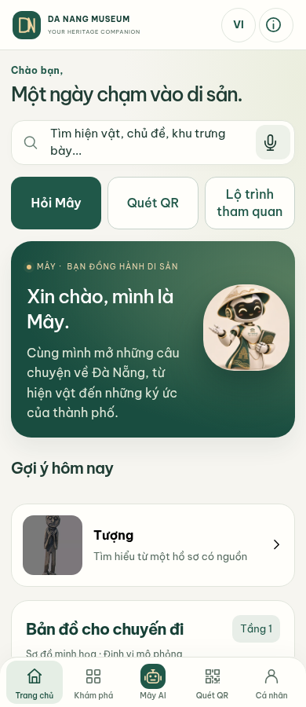
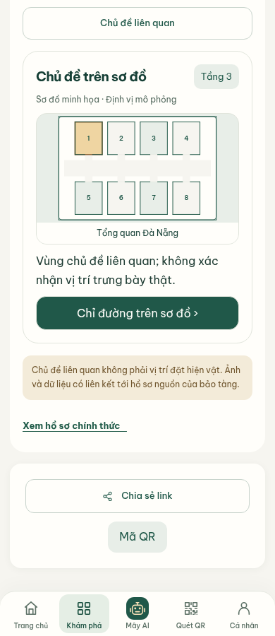
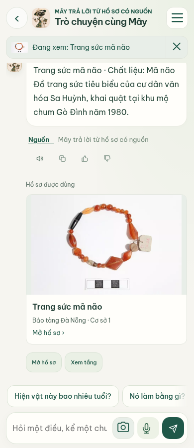
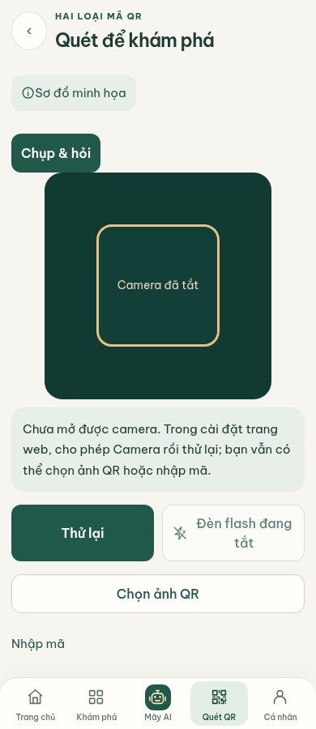
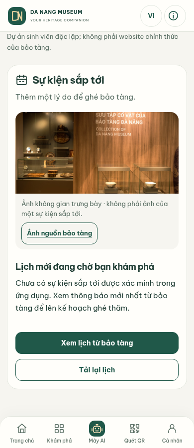

# Dọn giao diện — Museum Companion 7.5

Ngày 19/11/2026, giờ Việt Nam. Nâng cấp từ 7.4, giữ dữ liệu/ảnh gốc 200 hồ sơ, Mây, palette và bản đồ mô phỏng ba tầng.

## Tám mục đã xử lý

| Yêu cầu | Kết quả |
| --- | --- |
| Chia sẻ link thay hướng dẫn dùng điện thoại khác | Hai nút Chia sẻ link dùng chung URL hiện vật chuẩn. Ưu tiên navigator.share; sao chép khi không hỗ trợ/chia sẻ lỗi; hủy không tự sao chép; lỗi được báo rõ. QR vẫn có trong mục mở rộng và trang in. |
| Bỏ yêu cầu backend khỏi UI | Nhãn chính: **Mây trả lời từ hồ sơ có nguồn**. Có bản dịch EN/KO/ZH và trạng thái ngoại tuyến riêng; không giả AI tạo sinh khi chưa cấu hình model. |
| Quét QR | Vào tab tự xin camera, một nút đèn với trạng thái bật/tắt/không hỗ trợ. Nút thử lại chỉ xuất hiện khi camera lỗi. Phản hồi cũ khi rời trang không mở lại stream/RAF. Mã dùng thử chỉ hiện với `?debug=1`. |
| Bộ SVG chung | `MuseumIcons` cung cấp SVG nét tròn, currentColor, cùng hệ 24px; logo DN cùng màu nhận diện. Điều khiển chat, bản đồ, huy hiệu, micro và thanh nav dùng bộ này. Không dùng observer để sửa nội dung người dùng. |
| Mũi tên | Chevron cho điều hướng nội bộ. Ký hiệu/mũi tên mở ngoài chỉ ở link nguồn ngoài website. |
| Cảnh báo | Thu gọn vào chip Sơ đồ minh họa/QR minh họa, bấm để xem giải thích. Giữ phân biệt sơ đồ mô phỏng và vị trí thật. |
| Nhãn phiên bản | Bỏ 06/V6 khỏi tiêu đề và nội dung giao diện, kể cả thông báo xóa dữ liệu bốn ngôn ngữ. Khóa localStorage/CSS cũ được giữ để không làm mất tiến độ. |
| Sự kiện sắp tới | Tải từ `data/events.json` khi mở Tham quan. Hiện ngày, nguồn, ngày xác minh; lọc lịch đã kết thúc theo giờ Việt Nam. Có trạng thái trống/lỗi/thử lại và cache ngoại tuyến. |

Lượt kiểm tra ảnh còn sửa ba lỗi thực tế: giữ Mây đúng tỷ lệ 1:1, tách link nguồn ảnh sự kiện khỏi chú thích và chặn vòng lặp thu gọn header làm nút Hỏi Mây không ổn định. Header chỉ nhận diện hướng cuộn trở lại sau hai khung hình có chiều cao ổn định; kiểm tra cả chuyển động thường lẫn reduced motion.

## Sự kiện: tình trạng dữ liệu thật

Hiện `events: []`, `verifiedAt: null`. Môi trường không truy cập được website bảo tàng để xác minh lịch tương lai. Đường dẫn [Sự kiện chính thức](https://baotangdanang.vn/danh-cho-du-khach/su-kien) đã có trong bản điều hướng chính thức lưu từ trước; điều này **không xác minh sự kiện sắp diễn ra**. Giao diện nói rõ chưa có lịch được xác minh, không nói bảo tàng không tổ chức sự kiện.

Ảnh trong trạng thái trống là ảnh không gian trưng bày thật đã lưu trong dự án, có nhãn ảnh ngữ cảnh; không dùng làm poster sự kiện. Không thêm tên, ngày hoặc lịch giả. Các lịch tổng hợp chỉ nằm trong file kiểm thử, không xuất hiện trong JSON sản phẩm.

Khi có lịch chính thức, thêm vào JSON: `id`, `title` theo ngôn ngữ, `date` dạng YYYY-MM-DD, `sourceUrl` HTTPS của bảo tàng, `publishedAt` và `verifiedAt` thực tế. `start`/`end` có múi giờ nếu nguồn có giờ cụ thể; để cả hai null nếu chỉ biết ngày. Không tự điền giờ mở cửa làm giờ sự kiện. Cập nhật ngày xác minh của bộ dữ liệu. Nội dung chưa có bản dịch hiện nhãn ngôn ngữ nguồn. Lịch tương lai vẫn hiện cùng ngày xác minh gốc; không tự biến mất sau một số ngày tùy ý.

## Ảnh giao diện chạy thật











Ảnh là Chromium 390×900; tình huống quyền camera được giả lập. Không phải kết quả thử camera/đèn trên thiết bị vật lý.

## Các file chính

- `ui-icons.js/css`: bộ SVG, mount có phạm vi rõ, không thay văn bản hội thoại.
- `ui-cleanup.js/css`, `index.html`: nhãn QR, các vùng SVG tĩnh, nút chia sẻ và cảnh báo gọn.
- `app.js`: share/copy/cancel/failure, nhãn Mây, điều khiển SVG và chặn camera cũ sau video.play.
- `experience.js`, `experience-i18n.js`: trạng thái camera/đèn, debug QR và nhãn bốn ngôn ngữ.
- `v6.js`, `profile.js`, `live-map.js`, `live-map-features.js`, `map-journey.js`, `photo-query.js`, `visuals.js`: SVG điều khiển, điều hướng và bỏ nhãn phiên bản.
- `visit-events.js/css`, `data/events.json`: tải lịch theo nhu cầu, kiểm tra dữ liệu/ngày/nguồn, trạng thái trống và offline.
- `bootstrap.js`, `scripts/build-assets.mjs`, package/lock, `sw.js`: bundle 7.5 và cache JSON sự kiện; giữ ảnh đã xem khi nâng phiên bản.
- `tests/ui-cleanup.cjs`, `tests/ui-icons.test.mjs`, `tests/visit-events.test.mjs`: các tình huống mới; fixture ảnh được cập nhật để nạp thư viện SVG thật.
- `scripts/verify_published_v6.py` và workflow GitHub: kiểm tra bản 7.5 cùng nguồn JSON/CSS/module mới và 200 ảnh.

Các module có mã đầy đủ trong repository; bundle được tạo bằng `npm run build`, không sửa tay. ZIP bàn giao chứa nội dung đầy đủ các file thay đổi từ main 7.4; dùng cùng ảnh/corpus sẵn có trong repository.

## Chạy và kiểm thử

```sh
npm ci
npm run build
python3 -m http.server 8877 --bind 0.0.0.0
```

Nếu chạy server từ gốc repository: mở `/bao-tang-da-nang-v6/`; nếu chạy ngay trong thư mục ứng dụng: mở `/`. Trên Windows có thể dùng `py -3` thay `python3`.

```sh
npm test
# Cần Playwright + Chromium:
node tests/ui-cleanup.cjs
node tests/upgrade.cjs
node tests/live-map-final.cjs
node tests/live-map-stage3.cjs
node tests/mini-map.cjs
node tests/photo-cache-upgrade.cjs
```

Camera, clipboard và Web Share cần HTTPS (localhost phục vụ kiểm thử máy tính). Trên điện thoại thực dùng bản Pages/preview HTTPS. Không cần API key mới cho các thay đổi này. Không có khóa API ở frontend.

## Checklist thiết bị thật

- [ ] Safari iPhone/Chrome Android: màn 360–430px, nav/nhãn không bị cắt, không cuộn ngang.
- [ ] Hồ sơ → Chia sẻ link: mở bảng share, hủy không sao chép, trình duyệt thiếu share sao chép đúng hồ sơ.
- [ ] Quét: tự xin quyền, từ chối có hướng dẫn/thử lại; ra khỏi tab camera tắt. Bật/tắt đèn trên máy hỗ trợ; máy không có đèn nhận giải thích.
- [ ] Trang thường không có mã dùng thử; `?debug=1` có, `?demo=1` không có.
- [ ] VI/EN/KO/ZH: nhãn Mây, share, trạng thái camera và sự kiện đều đúng ngôn ngữ.
- [ ] Bấm chip để đọc giải thích mô phỏng; thông tin quan trọng vẫn còn trong phần mở rộng.
- [ ] PWA sau khi cache, mất mạng vẫn mở hồ sơ/lịch JSON đã lưu; nguồn ngoài cần mạng.

Kiểm thử tự động không thay kiểm tra share sheet, camera, torch hoặc bàn phím vật lý. Các kết quả local không đồng nghĩa đã xuất bản lên Pages.

## Kết quả kiểm tra bản bàn giao

- 151 bài Node và 19 bài Python đạt; gồm kiểm tra dữ liệu thật, nguồn, biểu tượng và lịch theo giờ Việt Nam.
- 8 nhóm UI mới đạt; thao tác từ cuối hồ sơ lên Hỏi Mây được lặp ba lần với cả animation thường và reduced motion.
- 24 nhóm hồi quy ứng dụng, 4 nhóm bản đồ, 4 nhóm Giai đoạn 3 và 6 nhóm mini-map đạt. Nâng từ service worker 7.0 giữ ảnh đã xem, tiến độ và hoạt động ngoại tuyến.
- Axe trên 10 màn: 0 lỗi WCAG2 A/AA tự động phát hiện. Đây không phải chứng nhận WCAG đầy đủ.
- Đủ 200 ảnh được giải mã từ HTTP local; corpus và ảnh gốc không đổi.
- Lighthouse mobile local: **89/100 hiệu năng, 100/100 accessibility, 100/100 best practices**. FCP 1,0s, LCP 3,6s, TBT 130ms, CLS 0,012; lượt tải đầu khoảng 430KiB. Không dùng số đo này để tuyên bố kết quả trên điện thoại vật lý hoặc Pages.

[Tổng hợp](validation-summary.json) · [UI mới](cleanup-tests.json) · [Hồi quy app](app-regressions.json) · [Trợ năng](accessibility-tests.json) · [Ảnh/asset](assets-and-photos.json) · [Cấu hình đo hiệu năng](performance-local.json).
